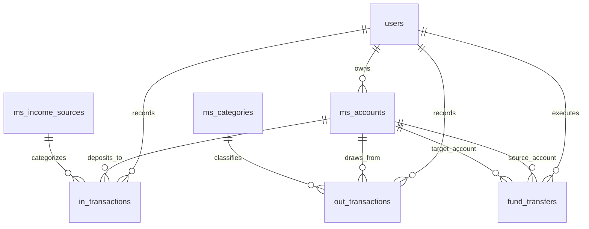
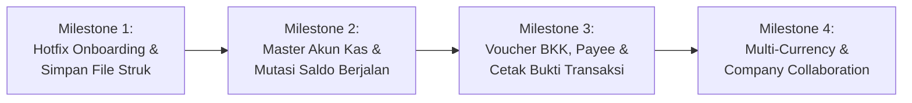

# PRD 08: Petty Cash (Kas Kecil) & Evolusi Pencatatan Keuangan Global

**Tanggal:** 2026-11-08  
**Nomor Dokumen:** 2026-11-08-08  
**Status:** COMPLETED (ALL 4 MILESTONES IMPLEMENTED & COMMITTED)  
**Dokumen Terkait:**  
- [PRD 01 Planning Perubahan Konsep](2026-10-03-01-planning-perubahan-konsep.md)  
- [PRD 02 Master Data Refactoring (Kategori & Budget Groups)](2026-10-03-02-prd-master-kategori-dan-budget-groups.md)  
- [PRD 03 Modul Pemasukan](2026-10-03-03-prd-modul-pemasukan.md)  
- [PRD 04 Modul Pengeluaran](2026-10-04-prd-modul-pengeluaran.md)  
- [PRD 05 Modul Laporan & Dashboard](2026-10-03-05-prd-modul-laporan-dan-dashboard.md)  
- [PRD 07 Siklus Anggaran Dinamis](2026-10-08-07-prd-siklus-anggaran-dinamis-dan-estimasi-kategori.md)  

---

## 1. Latar Belakang & Identifikasi Masalah

Sistem Castra saat ini dibangun di atas paradigma **Personal Envelope Budgeting (50/30/20)** yang dirancang untuk keuangan individu/keluarga. Ketika pengguna mencoba mendaftarkan akun baru (seperti `pc@mail.com`) untuk mengelola **Petty Cash (Kas Kecil)** atau kebutuhan pencatatan keuangan operasional organisasi/usaha, ditemukan sejumlah celah kritis:

1. **Cold-Start Problem (User Baru 100% Kosong)**:
   - Saat user baru dibuat (`UserController::store` / registrasi), sistem tidak menginisialisasi data master dasar (`ms_budget_groups`, `ms_categories`, `ms_income_sources`).
   - Akibatnya, form pemasukan dan pengeluaran tidak dapat digunakan karena dropdown pilihan kosong dan validasi backend menolak data.
2. **Ketiadaan Konsep Akun Kas & Saldo Berjalan (No Wallets / Accounts)**:
   - Pengeluaran (`out_transactions`) saat ini hanya mengikat `category_id` tanpa menghubungkan dari akun kas/bank mana uang tersebut keluar.
   - Tidak ada entitas "Kas Kecil" atau "Rekening Bank". Tidak ada saldo berjalan (*running balance*) atau sisa fisik kas saat ini (*current balance*).
3. **Kehilangan Bukti Fisik Nota/Struk Digital (*Receipt Loss*)**:
   - Fitur OCR (`ReceiptOcrService`) memindai gambar struk untuk ekstraksi data sementara, namun file gambar struk **dibuang** dan tidak disimpan ke database transaksi.
   - Pada standar audit dan kas kecil, ketiadaan lampiran nota membuat transaksi tidak dapat diverifikasi keabsahannya.
4. **Ketiadaan Alur Pengisian Kas Kecil (*Imprest & Replenishment*)**:
   - Kas kecil membutuhkan alur penarikan dana dari Bank ke Kas Kecil (*Fund Transfer / Top-up*). Saat ini tidak ada fitur mutasi/transfer antar-kas, sehingga pengisian kas kecil terpaksa dicatat sebagai "Pendapatan" yang mengacaukan kalkulasi omzet/laba.
5. **Ketiadaan Dokumen Bukti Transaksi (Nomor Voucher & Penerima Dana)**:
   - Tidak ada nomor Bukti Kas Keluar (BKK / PCV) dan nama penerima dana (*payee/vendor*), sehingga pencatatan belum memenuhi standar akuntansi bisnis.
6. **Keterbatasan Menuju Standar Global**:
   - Mata uang masih *hardcoded* IDR (Rupiah).
   - Pengeluaran hanya 1 transaksi = 1 kategori (belum mendukung split expense / rincian multi-item per nota).
   - Transaksi terisolasi per akun individual tanpa konsep *workspace / company / team sharing*.

---

## 2. Tujuan & Sasaran Pengembangan

1. **Dukungan Dual-Mode**: Menjadikan Castra fleksibel untuk pencatatan **Keuangan Pribadi** maupun **Petty Cash & Keuangan Bisnis/Operasional**.
2. **Akuntabilitas Saldo (Account & Cash Balance)**: Menghadirkan master Akun Kas & Bank (`ms_accounts`), pencatatan transfer antar-akun, dan kalkulasi saldo berjalan (*running balance*).
3. **Penyimpanan Permanen Bukti Transaksi**: Menyimpan berkas gambar struk/nota digital hasil OCR langsung ke penyimpanan transaksi sebagai bukti fisik audit.
4. **Kelengkapan Dokumen Kas Kecil**: Menyediakan nomor voucher otomatis (`voucher_no`), pihak penerima (*payee*), status approval, dan template cetak Bukti Kas Keluar (BKK).
5. **Instant Onboarding**: User baru yang mendaftar langsung mendapatkan master template otomatis (pilihan template: *Personal* atau *Petty Cash / Usaha*) sehingga aplikasi siap pakai tanpa konfigurasi manual yang rumit.

---

## 3. Arsitektur & Skema Database

### 3.1 Tabel Baru: `ms_accounts` (Akun Kas & Bank)
Mencatat wadah/kantong penyimpanan dana:
- `id` (bigint unsigned, PK)
- `user_id` (bigint unsigned, FK -> `users.id`, cascade)
- `name` (varchar 100) — contoh: `"Kas Kecil (Petty Cash)"`, `"Kas Utama Brankas"`, `"BCA Operasional"`
- `type` (enum: `'petty_cash'`, `'cash'`, `'bank'`, `'e_wallet'`, `'other'`)
- `account_number` (varchar 50, nullable) — nomor rekening / identitas dompet
- `currency` (varchar 10, default `'IDR'`)
- `initial_balance` (decimal 15,2, default 0.00) — saldo awal pembukaan akun
- `current_balance` (decimal 15,2, default 0.00) — saldo berjalan aktual
- `imprest_limit` (decimal 15,2, nullable) — plafon dana kas kecil (opsional untuk sistem imprest)
- `is_active` (boolean, default true)
- `created_at`, `updated_at`

### 3.2 Tabel Baru: `fund_transfers` (Mutasi Antar Kas / Pengisian Kas Kecil)
Mencatat perpindahan dana (misal: Bank -> Kas Kecil):
- `id` (bigint unsigned, PK)
- `user_id` (bigint unsigned, FK -> `users.id`, cascade)
- `from_account_id` (bigint unsigned, FK -> `ms_accounts.id`, restrict)
- `to_account_id` (bigint unsigned, FK -> `ms_accounts.id`, restrict)
- `transfer_date` (date)
- `amount` (decimal 15,2)
- `reference_no` (varchar 50, nullable) — No. referensi bank / penarikan cek
- `notes` (text, nullable)
- `attachment_path` (varchar 255, nullable) — bukti transfer / slip penarikan
- `created_at`, `updated_at`

### 3.3 Penambahan Kolom pada `out_transactions` (Pengeluaran)
- `account_id` (bigint unsigned, nullable, FK -> `ms_accounts.id`) — akun pemotong dana
- `voucher_no` (varchar 50, nullable, indexed) — contoh: `"BKK-202611-001"`
- `payee` (varchar 150, nullable) — penerima dana / toko / vendor
- `attachment_path` (varchar 255, nullable) — path berkas nota fisik
- `status` (enum: `'completed'`, `'pending'`, `'draft'`, default `'completed'`)

### 3.4 Penambahan Kolom pada `in_transactions` (Pemasukan)
- `account_id` (bigint unsigned, nullable, FK -> `ms_accounts.id`) — akun penampung dana
- `voucher_no` (varchar 50, nullable, indexed) — contoh: `"BKM-202611-001"`
- `attachment_path` (varchar 255, nullable) — bukti transfer masuk
- `status` (enum: `'completed'`, `'pending'`, `'draft'`, default `'completed'`)

---

## 4. Desain Alur Fitur & Antarmuka (UI/UX)

### 4.1 Onboarding Otomatis Pengguna Baru
Saat akun baru dibuat (seperti `pc@mail.com`), sistem menjalankan `UserAccountInitializer`:
1. Membuat akun default:
   - `Kas Kecil (Petty Cash)` (type: `petty_cash`)
   - `Kas Utama / Rekening Utama` (type: `bank`)
2. Mengisi kelompok anggaran & kategori standar:
   - Kategori Operasional Kas Kecil: *Alat Tulis Kantor (ATK)*, *Konsumsi & Pantry*, *Bensin & Transportasi*, *Kurir & Ekspedisi*, *Perawatan & Kebersihan*, *Biaya Operasional Lainnya*.
3. Pengguna baru dapat langsung menginput transaksi tanpa error form kosong.

### 4.2 Penyimpanan & Pratinjau Berkas Struk Permanen
1. **Upload & OCR Terintegrasi**:
   - Pengguna mengunggah atau mem-paste (Ctrl+V) foto struk ke modal pengeluaran.
   - OCR memproses teks dan mengisi otomatis tanggal, nominal, dan toko.
   - File gambar disimpan ke storage server (`storage/app/public/receipts/...`).
2. **Pratinjau Bukti Transaksi**:
   - Riwayat transaksi di tabel menyertakan ikon nota/lampiran.
   - Klik thumbnail untuk melihat gambar nota asli secara penuh (*lightbox viewer*).

### 4.3 Alur Pengisian Kembali Kas Kecil (*Top-Up Petty Cash*)
1. Tersedia tombol cepat **"Isi Kas Kecil"** di Dashboard & Kalender.
2. Form mencatat:
   - *Dari Akun*: Bank BCA / Kas Utama
   - *Ke Akun*: Kas Kecil
   - *Nominal Pengisian*: Otomatis menyarankan sisa plafon atau input bebas.
3. Transaksi ini tidak menambah omzet pemasukan, melainkan memutasi saldo akun secara akurat.

### 4.4 Penerbitan & Cetak Bukti Kas Keluar (BKK)
1. Setiap transaksi kas keluar menghasilkan nomor voucher urut per bulan (misal `BKK-2026/11/001`).
2. Terdapat tombol **"Cetak Voucher"** yang membuka lembar cetak standar A5/A4 lengkap dengan:
   - Header Nama Perusahaan / Unit
   - Tanggal, No. Voucher, Jumlah Terbilang (Rupiah)
   - Keterangan & Penerima Uang (*Payee*)
   - Kotak Tanda Tangan: Disetujui Oleh, Dibayar Oleh (Kasir Kas Kecil), Diterima Oleh.

---

## 5. Rencana Tahapan Eksekusi (Implementation Milestones)

### Milestone 1: Quick-Wins & Perbaikan Celah Utama (Completed - Commit `93fcd2e`)
1. [x] **Auto-Seed Template User Baru**:
   - `UserTemplateInitializer` otomatis menyiapkan kategori, sumber dana, budget group, dan akun kas saat user baru terdaftar.
2. [x] **Penyimpanan Permanen File Nota/Struk**:
   - Kolom `attachment_path` pada `out_transactions` & `in_transactions`.
   - File upload OCR disimpan di storage publik `receipts/`.
   - Thumbnail dan modal pratinjau bukti nota di riwayat transaksi.

### Milestone 2: Sistem Akun Kas & Saldo Berjalan (Completed - Commit `e7ecbfc`)
1. [x] Tabel `ms_accounts` dan `fund_transfers`.
2. [x] Pilihan "Akun Pembayaran / Kas" di form Pemasukan dan Pengeluaran.
3. [x] UI Transfer Antar Kas (*Top-Up Kas Kecil* via `FundTransferModal`).
4. [x] Widget kartu *Saldo Kas Kecil Saat Ini* di Dashboard lengkap dengan progress limit imprest.

### Milestone 3: Dokumen & Tata Kelola Operasional Kas Kecil (Completed - Commit `a47aa23`)
1. [x] Generator otomatis nomor voucher transaksi (`voucher_no`: `BKK-YYYYMM-XXXX` & `BKM-YYYYMM-XXXX`).
2. [x] Input pihak penerima (*payee*) pada modal pengeluaran.
3. [x] Helper konversi Terbilang Rupiah formal akuntansi (`terbilang.js`).
4. [x] Template cetak Voucher Bukti Kas Keluar (BKK) & Bukti Kas Masuk (BKM) siap tanda tangan 3 otoritas (`VoucherModal.js`).
5. [x] Laporan Buku Kas Kecil (*Petty Cash Book Ledger*) dengan kalkulasi saldo awal, mutasi masuk/keluar, running balance, ekspor CSV, dan print A4 (`PettyCashBookReport.js`).

### Milestone 4: Standar Global & Kolaborasi Organisasi (Completed - Commit `b17b688`)
1. [x] Dukungan multi-mata uang (*currency settings per account*: IDR, USD, EUR, SGD, MYR, JPY, GBP, AUD).
2. [x] Opsi split-kategori pada satu transaksi nota belanja (`splits` payload & relasi `parent_id`).
3. [x] Mode multi-user dengan alur persetujuan Maker & Approver (*Draft*, *Submitted*, *Approved*, *Rejected*).
4. [x] Rekalkulasi saldo akun otomatis hanya memotong transaksi yang telah disetujui (*Approved*).

---

## 6. Kriteria Penerimaan (*Acceptance Criteria - All Verified*)

1. [x] **User Baru Langsung Siap Pakai**: User baru (seperti `pc@mail.com`) langsung memiliki akun Kas Kecil (plafon Rp 2.000.000) dan kategori operasional standar.
2. [x] **Nota Tersimpan & Terbaca**: Gambar nota tersimpan permanen dan dapat dilihat kembali dari riwayat transaksi.
3. [x] **Saldo Kas Terhitung Akurat**: Saldo kas kecil berkurang saat transaksi *approved*, dan bertambah saat ada mutasi transfer dari bank.
4. [x] **Voucher Terbit**: Nomor voucher unik tercetak lengkap dengan penerima dana, nominal terbilang, dan tanda tangan otoritas.
5. [x] **Split & Multi-Currency**: Nota belanja multi-item dapat dipecah ke beberapa kategori sekaligus dan mata uang akun tercatat dinamis.
6. [x] **Zero Regression**: Seluruh 74 feature & unit test backend lulus 100%, frontend Vite build lolos tanpa error.
